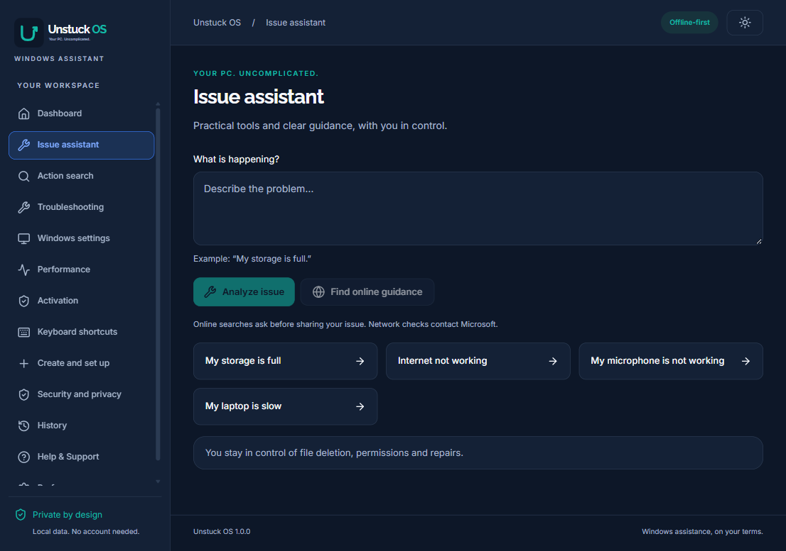
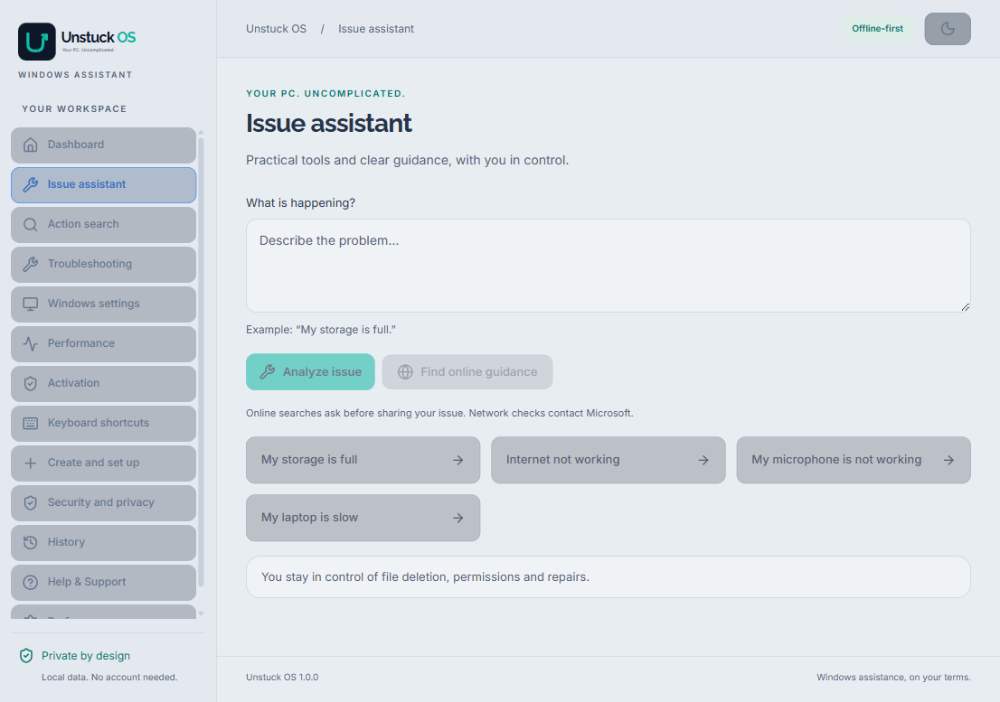
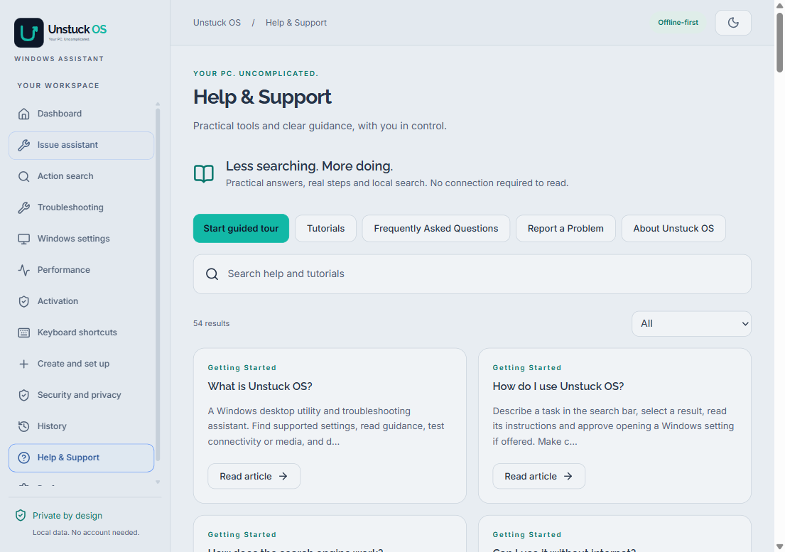
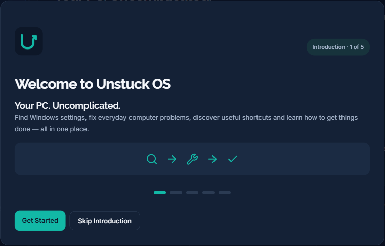
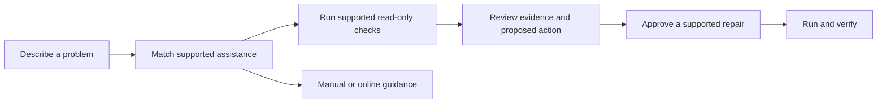

<div align="center">

<picture>
  <source media="(prefers-color-scheme: dark)" srcset="store-assets/brand/wordmark-dark.svg">
  <source media="(prefers-color-scheme: light)" srcset="store-assets/brand/wordmark-light.svg">
  
</picture>

### Your PC. Uncomplicated.

Find Windows settings, understand everyday problems, discover shortcuts,<br>
and run supported repairs—with you in control.

[](package.json)


<br>


**[Explore the app](#what-is-unstuck-os)** ·
**[Screenshots](#screenshots)** ·
**[Get started](#quick-start)** ·
**[Documentation](#documentation)** ·
**[Report an issue](https://github.com/brainiacweb-tech/Unstuck-OS/issues)**

*Less searching. More doing.*

</div>

---

> [!NOTE]
> **Current release status:** Unstuck OS is a functional development candidate. You can build and run it from source today. A signed public installer and Microsoft Store publication are still pending; this repository currently has no published release download.

## What is Unstuck OS?

Windows can make simple tasks surprisingly hard to find. Unstuck OS brings practical computer assistance into one desktop workspace: describe a problem, find the right setting, inspect diagnostic evidence, or follow a clear tutorial.

You do not need an account, a subscription, or a paid AI service. Supported help and local tools work offline. Network tests and optional online guidance use the internet where needed.

| If you want to… | Start here |
|---|---|
| Find a hidden Windows setting | Search for a task such as **“Change date and time”** |
| Work through a computer problem | Describe it in **Issue assistant** |
| Check internet, microphone or camera behavior | Open **Troubleshooting** |
| Understand memory, storage and uptime | Open **Performance** |
| Find a useful key combination | Search **Keyboard shortcuts** |
| Learn at your own pace | Read **Help & Support**, FAQs and tutorials |

## Screenshots

### One place to describe the problem

<p align="center">
  
  <br>
  <sub>Describe an issue, start supported checks, and review the next step.</sub>
</p>

<details>
<summary><strong>See the softer light theme</strong></summary>
<br>
<p align="center">
  
</p>
</details>

<details>
<summary><strong>Explore the offline Help Center</strong></summary>
<br>
<p align="center">
  
</p>
</details>

<details>
<summary><strong>A welcoming first launch</strong></summary>
<br>
<p align="center">
  
</p>
</details>

*These are captures of the running application in an isolated profile, not mockups. No diagnostic results were fabricated or personal machine details included.*

## Features

| Feature | What you can do |
|---|---|
| **Universal search** | Find supported tasks and guides through local keyword and typo-tolerant search. |
| **Windows Settings Explorer** | Review a task, then approve opening the relevant Windows settings page. |
| **Issue assistant** | Describe a problem, gather supported evidence, and review available repairs or guidance. |
| **Storage cleanup** | Preview eligible older temporary files, select exact candidates, approve deletion, and check free space again. |
| **DNS repair and verification** | Approve a fixed DNS-cache repair, then let the app run before-and-after connectivity checks. |
| **Media checks** | Test camera and microphone access locally, with a preview or live level meter. |
| **Performance snapshot** | Inspect local CPU model, available memory, storage, uptime and available Windows information. |
| **Activation assistance** | Read local Windows licensing status and follow legitimate Windows or Office activation guidance. |
| **Shortcut library** | Search, copy and favorite useful Windows keyboard shortcuts. |
| **Quick Access** | Open a compact floating search window using a configurable global shortcut. |
| **Help and onboarding** | Use a five-screen introduction, a ten-step live tour, 35 help articles, FAQs and 19 practical tutorials. |
| **Private problem reports** | Preview a report, optionally include diagnostic findings, then copy it or save a local text file. |
| **Personal workspace** | Keep favorites and recent tasks, manage optional history, and choose dark or soft light mode. |

## Try it yourself

### Find a Windows setting

1. Press **Ctrl + K** and search for **“Date and time”**.
2. Open the matching task and read the instructions.
3. Choose **Approve opening settings**.
4. Make the change in Windows and verify the result yourself.

### Work through a full-storage request

1. Open **Issue assistant** and type **“My storage is full”**.
2. Select **Analyze issue**. The scan itself does not delete anything.
3. Review eligible older temporary files and select only files you no longer need.
4. Review the native confirmation before approving permanent deletion.
5. Read the actual deleted/skipped counts and the new free-space measurement.

The scan covers only top-level `.tmp` and `.temp` files at least seven days old in your user Temp folder. Personal folders and subfolders are excluded. A file's age does not prove that it is unnecessary; Windows Storage settings is available for a broader manual review.

### Learn a feature without running a repair

Open **Help & Support**, search for **“microphone”**, and read an article or tutorial. Choose **Start guided tour** to explore real controls. The tour does not run repairs or destructive actions.

## How assistance works



Unstuck OS distinguishes a successful check, an accepted Windows navigation request, and a completed repair. None of those alone proves that every part of a computer problem has been solved.

## Quick start

### Requirements

- A Windows development machine. The app targets **Windows 10 build 19041 or later and Windows 11, x64**; feature availability varies by Windows version, hardware and policy.
- A supported **Node.js LTS** installation with **npm**.
- **Git** to clone the repository.

### Run from source

```powershell
git clone https://github.com/brainiacweb-tech/Unstuck-OS.git
cd Unstuck-OS
npm ci
npm run dev
```

`npm run dev` compiles the app and launches Electron. There is no hot-reload development server; stop and rerun it after edits. Dependency installation requires internet access. End users of a packaged build do not need Node.js installed separately.

<details>
<summary><strong>Electron runs but no window appears?</strong></summary>

If your terminal sets `ELECTRON_RUN_AS_NODE`, Electron runs as a command-line process. Clear that variable in the current PowerShell session and try again:

```powershell
Remove-Item Env:ELECTRON_RUN_AS_NODE -ErrorAction SilentlyContinue
npm run dev
```

</details>

### Build a Windows package

Run packaging commands sequentially:

```powershell
npm run package      # Portable Windows executable
npm run installer    # Per-user NSIS installer
```

Generated files are written to `release/` and are not committed to Git. Current test binaries are unsigned. MSIX packaging additionally requires real Partner Center identity values and Windows SDK tools; see the [build guide](docs/BUILD.md) and [Store publishing guide](docs/STORE_PUBLISHING.md).

## Development and testing

| Command | Purpose |
|---|---|
| `npm run lint` | ESLint and TypeScript checks |
| `npm test` | Unit tests, including isolated cleanup safety fixtures |
| `npm run build` | Type-check and compile renderer, main process and preload |
| `npm run test:e2e` | Existing Electron diagnostics/settings regression |
| `npm run test:help` | Onboarding, tour, offline help, About and report workflows |
| `npm run test:repairs` | Issue matching, cleanup scan, online consent and DNS workflow checks |
| `node scripts/layout-smoke.cjs` | Layout checks across desktop sizes and both themes |
| `node scripts/brand-smoke.cjs` | Fonts, colors, logos and theme persistence |

**Latest verified checks:** 77 unit tests passed, along with lint, TypeScript, production compilation and the Electron assistance/repair regressions. The responsive layout audit passed 66 page/content checks across **1280×850**, **1024×768** and **800×600**, in dark and light mode. These are recorded local checks, not a hosted CI status or a claim of complete hardware coverage.

Electron tests use isolated profiles. Cleanup deletion is tested on generated fixtures; the repair smoke test intercepts the DNS command so it does not alter the computer's DNS cache. Camera/microphone hardware, Windows edition differences and assistive technologies still need manual acceptance testing.

See [Testing](docs/TESTING.md), [repair verification](docs/ISSUE-ASSISTANT.md) and [layout verification](docs/LAYOUT-REFINEMENT.md). Generated QA reports and local diagnostic screenshots are excluded from Git.

## Architecture

| Layer | Responsibility |
|---|---|
| **React renderer** | Pages, accessible controls, local search, onboarding, tour and previews |
| **Sandboxed preload** | A narrow, frozen API between the UI and native functionality |
| **Electron main process** | Trusted-frame validation, Windows navigation, permissions, diagnostics, report export and approved repairs |
| **Shared data and policy** | Task catalogue, help content, bounded input validation and report formatting |

Windows commands are fixed and allowlisted. Issue text and online content never become executable commands. Cleanup plans are owned by the native process; the renderer selects opaque IDs rather than sending arbitrary file paths.

```text
Unstuck-OS/
├── src/
│   ├── data/           # Tasks, shortcuts, help and support configuration
│   ├── main/           # Electron, diagnostics, Windows queries and repairs
│   ├── preload/        # Narrow IPC bridge
│   ├── renderer/       # React pages, components, themes and brand assets
│   └── shared/         # Contracts, search, policy and validation
├── tests/              # Unit tests and isolated filesystem fixtures
├── scripts/            # Build helpers, screenshots and Electron checks
├── docs/               # User, architecture, security and release guides
└── store-assets/       # Branding, icons, licence notices and Store templates
```

**Built with:** Electron, React, TypeScript, Node.js, Vite, Tailwind CSS, Fuse.js and Lucide. Raleway, Inter and JetBrains Mono are bundled locally for branding, UI and technical information.

## Privacy and safety

- **Local by default.** No account, analytics or cloud AI service is required. Preferences and optional diagnostic history stay in your Windows user profile.
- **Explicit file deletion.** Temporary-file cleanup starts with a preview, leaves everything unselected, and requires native approval. Deletion is permanent; changed, locked or inaccessible files are skipped.
- **Permission-aware media.** Camera and microphone tests use Windows and app permissions. Media is processed locally, never recorded or uploaded, and stops when you leave the test.
- **Clear network boundaries.** Internet checks contact Microsoft endpoints. Online guidance asks before sending your reviewed issue text to Microsoft Support in your browser; no files or diagnostic findings are attached.
- **Deliberate reporting.** Reports require a preview before copying or saving. Nothing is sent automatically.
- **Legitimate licensing only.** Activation assistance does not bypass Windows or Office licensing and never asks you to enter a product key into Unstuck OS.

Read the [privacy documentation](docs/PRIVACY.md) and [supported repair boundaries](docs/ISSUE-ASSISTANT.md).

## Documentation

| Guide | What it covers |
|---|---|
| [User guide](docs/USER_GUIDE.md) | Finding tasks, using help and working through issues |
| [Onboarding and Help Center](docs/HELP-ONBOARDING.md) | Introduction, tour, tutorials, About and local reports |
| [Issue assistant](docs/ISSUE-ASSISTANT.md) | Cleanup, DNS repair, online consent and actual limits |
| [Architecture](docs/ARCHITECTURE.md) | Renderer/main boundaries and local state |
| [Security](docs/SECURITY.md) | Permissions, IPC and Windows integration |
| [Brand identity](docs/BRAND.md) | Logo, colors, type and the softer light theme |
| [Build and packaging](docs/BUILD.md) | Local compilation and Windows executables |
| [Microsoft Store publishing](docs/STORE_PUBLISHING.md) | Identity, SDK and submission requirements |
| [Known limitations](docs/KNOWN_LIMITATIONS.md) | Outstanding compatibility and release checks |

## Release priorities

- [x] Search, settings discovery, shortcuts and local system information
- [x] Onboarding, guided tour, Help Center, tutorials and About
- [x] Approved temporary-file cleanup and DNS repair with verification
- [x] Dark and soft light themes with responsive desktop layouts
- [ ] Complete real-device Windows 10/11, media and accessibility acceptance
- [ ] Produce and verify current signed distribution packages
- [ ] Configure a verified developer support destination
- [ ] Complete Microsoft Store identity, packaging and certification

There is no automatic updater in this build, and Unstuck OS does not claim to fix every computer issue. Unsupported, privileged or hardware-related problems may require manual help. See [Known limitations](docs/KNOWN_LIMITATIONS.md).

## Contributing and feedback

Have a reproducible bug, a clearer explanation, or a supported task to suggest? [Open an issue](https://github.com/brainiacweb-tech/Unstuck-OS/issues).

Include the Windows version, what you expected, what happened and steps to reproduce. Remove personal details, passwords and product keys. If you use **Report a Problem** in the app, review its preview before choosing what to share.

For code changes, run the relevant unit and Electron checks. Keep native actions allowlisted, preserve explicit approval for destructive operations, and update the local help when behavior changes. Do not commit dependency folders, installers, credentials or machine-specific diagnostic output.

## Creator and acknowledgements

**Developed by Francis Kusi.**

Unstuck OS was created to make everyday computer tasks easier for everyone. From finding hidden Windows settings and discovering shortcuts to troubleshooting common problems, Unstuck OS brings practical computer assistance into one simple application.

Third-party software and fonts retain their respective licences; bundled notices are available in [store-assets/licenses](store-assets/licenses). This repository does not assign an MIT or other project-wide open-source licence.

<p align="center">
  <strong>Less searching. More doing.</strong><br>
  © 2026 Francis Kusi. All rights reserved.<br>
  <sub>Unstuck OS is an independent desktop application and is not affiliated with or endorsed by Microsoft.</sub>
</p>
